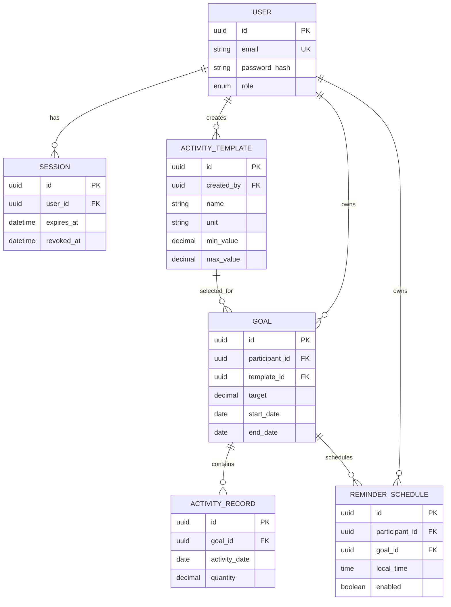

# System SDS — Sprint 1 baseline

## 1. Architecture and responsibilities

The planned implementation is a web client, REST API, and relational database. The UI sends HTTPS JSON requests to the API. The API authenticates the session, authorizes by role and owner, validates input, runs domain calculations, and performs transactional database operations. The database owns persistence constraints such as foreign keys and the unique daily-record key; the API owns user-facing rule errors and progress formatting.

Planned stack: React/TypeScript client; Node.js/TypeScript REST service; PostgreSQL; bcrypt; server-side sessions; automated unit/integration/end-to-end tests. Exact framework selection remains an implementation detail as long as the contracts below remain stable.

## 2. Entities, ownership, and constraints

| Entity | Key fields | Constraints / ownership |
|---|---|---|
| User | `id`, `email`, `password_hash`, `role`, `created_at` | Unique normalized email; role is `PARTICIPANT` or `PROGRAM_MANAGER`; password hash only. |
| Session | `id`, `user_id`, `expires_at`, `created_at`, `revoked_at` | Foreign key to User; expires and can be revoked at logout. |
| ActivityTemplate | `id`, `name`, `description`, `unit`, `min_value`, `max_value`, `is_active`, `created_by`, timestamps | Created/maintained by manager; `min_value <= max_value`; `unit` immutable in S1. |
| Goal | `id`, `participant_id`, `template_id`, `target`, `start_date`, `end_date`, timestamps | Participant-owned; target positive and within template range; no edit/delete S1. |
| ActivityRecord | `id`, `goal_id`, `activity_date`, `quantity`, `created_at` | Goal-owned; quantity in inclusive template range; unique `(goal_id, activity_date)`; no overwrite. |
| ReminderSchedule (placeholder) | `id`, `participant_id`, `goal_id`, `local_time`, `days_of_week`, `enabled` | Deferred to S3; representation only, no dispatcher/notification. |

### ER diagram



## 3. Setup, migrations, and seed data

Local setup uses `.env` from `.env.example`, installs dependencies, starts PostgreSQL, runs versioned migrations, then starts API and UI. Migrations create tables, enums, indexes, foreign keys, the unique daily-record constraint, and seed a non-production manager, participant, and study templates only when explicitly requested. Seed passwords are development-only and never used in deployed environments. CI runs migrations against an ephemeral database and does not reuse developer data.

## 4. Screens and navigation

Routes: `/login`; `/dashboard` (participant goals and progress); `/goals/new`; `/goals/:id` (summary and history); `/templates` (manager catalog); `/templates/new` and `/templates/:id/edit` (manager only). The top-level shell provides logout and current-user display.

All screens use shared loading, empty, validation-error, unauthorized, not-found, conflict, and retryable-server-error states. Forms validate client-side for usability, but the API repeats every rule. Empty states explain the next permitted action; no private data is rendered from a failed authorization response.

## 5. API conventions

JSON error shape:

```json
{
  "error": { "code": "DUPLICATE_DAILY_RECORD", "message": "A record already exists for this goal and date.", "details": {} }
}
```

Status codes: 200 read/update, 201 create, 204 logout, 400 validation, 401 missing/expired session, 403 authenticated but forbidden, 404 resource not found or intentionally hidden by privacy policy, 409 duplicate/conflicting state, 500 unexpected server error. Protected request checks occur in this order: **401 → 403 → 404 → 400 → 409**. The API does not reveal whether another participant's private resource exists.

| Method | Endpoint | Purpose |
|---|---|---|
| POST | `/api/auth/login` | Create session. |
| POST | `/api/auth/logout` | Revoke current session. |
| GET | `/api/me` | Current user and role. |
| POST | `/api/templates` | Manager creates template. |
| GET | `/api/templates` | Authenticated user lists active templates. |
| PATCH | `/api/templates/:id` | Manager updates allowed metadata; rejects `unit`. |
| POST | `/api/goals` | Participant creates goal. |
| GET | `/api/goals` | Participant lists own goals. |
| GET | `/api/goals/:id` | Participant retrieves own goal, summary, and permitted history. |
| POST | `/api/goals/:id/records` | Participant creates one daily record. |
| GET | `/api/goals/:id/records` | Participant lists own goal records. |
| GET | `/api/goals/:id/progress` | Participant receives computed progress. |

## 6. Role/permission matrix for every Sprint 1 endpoint

`PM` = Program Manager, `P` = Participant, `Auth` = any authenticated user, `—` = not permitted.

| Endpoint | Anonymous | PM | P | Ownership/notes |
|---|---:|---:|---:|---|
| POST `/api/auth/login` | ✓ | ✓ | ✓ | Valid credentials only. |
| POST `/api/auth/logout` | 401 | ✓ | ✓ | Current session only. |
| GET `/api/me` | 401 | ✓ | ✓ | Current user only. |
| POST `/api/templates` | 401 | ✓ | 403 | Manager creates. |
| GET `/api/templates` | 401 | ✓ | ✓ | Active shared catalog; no private records. |
| PATCH `/api/templates/:id` | 401 | ✓ | 403 | Manager only; `unit` rejected for all roles. |
| POST `/api/goals` | 401 | 403 | ✓ | Goal owner is current participant. |
| GET `/api/goals` | 401 | 403 | ✓ | Own goals only. |
| GET `/api/goals/:id` | 401 | 403 `ROLE_FORBIDDEN` | owner ✓, other 404 | Managers have no private-goal access. |
| POST `/api/goals/:id/records` | 401 | 403 `ROLE_FORBIDDEN` | owner ✓, other 404 | Managers have no record-creation access. |
| GET `/api/goals/:id/records` | 401 | 403 `ROLE_FORBIDDEN` | owner ✓, other 404 | Managers have no private-history access. |
| GET `/api/goals/:id/progress` | 401 | 403 `ROLE_FORBIDDEN` | owner ✓, other 404 | Managers have no progress access. |

The automated matrix tests both cross-participant access and a participant attempting to edit a shared template. No role receives consent-based sharing in Sprint 1.

## 7. Credential and session handling

Login normalizes the email, loads the user, compares the submitted password with bcrypt, and returns a generic failure for invalid credentials. Passwords are never logged or returned. On success the server creates a random opaque session ID, stores its hash/record with an expiry, and sets an HTTPS-only, `HttpOnly`, `SameSite=Lax` cookie. Middleware retrieves the current user from the non-revoked, non-expired session on every protected request. Logout revokes the session and clears the cookie. Session expiry is configurable, with a planned default of 24 hours. CSRF protection is required for cookie-authenticated state-changing requests.

## 8. Environment and planned GCP deployment

Required configuration includes `APP_ENV`, `APP_TIMEZONE` (default `Asia/Bangkok`), `DATABASE_URL`, `SESSION_SECRET`, `SESSION_TTL`, `BCRYPT_COST`, and allowed UI origin. Secrets are supplied through Secret Manager or local uncommitted environment files; `.env` is ignored and `.env.example` contains names only.

Planned GCP components: Artifact Registry stores versioned images; Cloud Run hosts the UI/API services; Cloud SQL for PostgreSQL stores relational data; Secret Manager injects database/session secrets. IAM service accounts use least privilege. TLS, Cloud Run ingress, database backups, and structured logs are deployment concerns; logs must exclude passwords, cookies, and private activity payloads.

